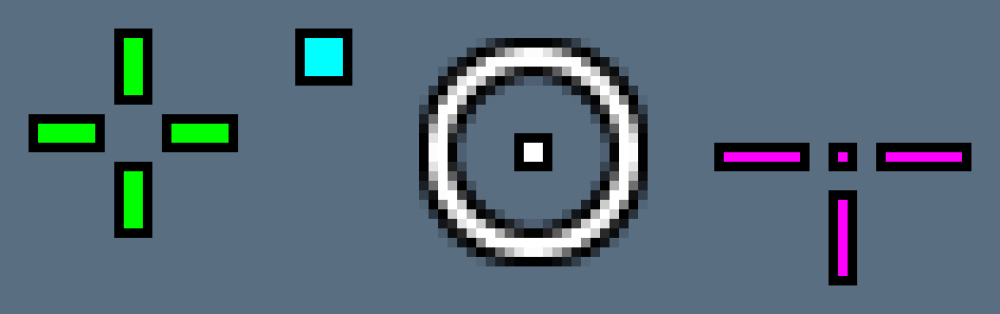

# crosslay

A tiny screen overlay written in Rust. It starts with crosshairs; image overlays come next.



## Why it's light

crosslay draws the crosshair **once**, hands the pixels to the Windows compositor (DWM) as a
layered window, and then sleeps. It has no render loop, no GPU context, and doesn't poll
every frame, so it adds no frame-time cost to your game:

- One click-through, top-most, non-activating popup window (`WS_EX_LAYERED | WS_EX_TRANSPARENT`).
  It never takes focus and doesn't appear in Alt+Tab.
- Pixels go up through `UpdateLayeredWindow` only when something changes: startup, a profile
  switch, a config edit, or a display change.
- The main thread blocks in `GetMessageW`. A 1.5 s timer re-asserts top-most and checks the
  config file's modified time. Nothing else runs.
- It's DPI-aware per monitor, so a 1 px line is one physical pixel at any scaling.
- The only dependencies are `windows-sys` (raw bindings), `serde` and `toml`. The release build
  uses LTO, `panic = "abort"`, and stripped symbols.

It's a normal desktop window. It doesn't inject into or hook any game process. That means it
shows over **windowed and borderless-windowed** games, not over exclusive fullscreen.

## Usage

```
crosslay                     # run the overlay
crosslay --config my.toml    # use a specific config file
crosslay --preview out.png   # render the startup crosshair to a PNG (works on any OS)
crosslay --print-config      # print the default, commented config
crosslay --config-path       # show which config file would be used
```

Default hotkeys (change them in the config):

| Hotkey           | Action                      |
|------------------|-----------------------------|
| `Ctrl+Alt+X`     | Show / hide the overlay     |
| `Ctrl+Alt+Right` | Next crosshair profile      |
| `Ctrl+Alt+Left`  | Previous crosshair profile  |
| `Ctrl+Alt+R`     | Reload the config           |
| `Ctrl+Alt+Q`     | Quit                        |

## Configuration

On first run crosslay writes a commented default config to `%APPDATA%\crosslay\config.toml`.
If there's a `crosslay.toml` next to the executable, crosslay uses that file instead
(portable mode). While crosslay runs, it applies edits as soon as you save the file.

```toml
monitor = 0          # 0 = primary monitor, 1.. = other monitors
profile = 0          # startup profile index
visible = true
live_reload = true

[hotkeys]
toggle = "Ctrl+Alt+X"
next = "Ctrl+Alt+Right"
previous = "Ctrl+Alt+Left"
reload = "Ctrl+Alt+R"
quit = "Ctrl+Alt+Q"     # "" disables a hotkey

[[crosshair]]
name = "Classic"
color = "#00FF00"       # "#RRGGBB" or "#RRGGBBAA"
thickness = 2
length = 6              # 0 hides the arms
gap = 3
t_style = false         # hide the top arm
center_dot = false
dot_size = 2
circle_radius = 0       # 0 = no circle
circle_thickness = 1
outline = 1             # 0 = no outline
outline_color = "#000000"
offset_x = 0
offset_y = 0
```

Add as many `[[crosshair]]` profiles as you like and cycle through them with the hotkeys.

## Building

```
cargo build --release
```

The live overlay is Windows-only for now. `--preview`, the config handling, and the tests run
anywhere.

### Prebuilt exe

The **Build exe** workflow (`.github/workflows/build-exe.yml`) builds standalone x64 and ARM64
exes. They don't need the Visual C++ Redistributable.

- **Every push:** download the exe from the workflow run's *Artifacts* section in the Actions tab.
- **On demand:** Actions → *Build exe* → *Run workflow*.
- **Releases:** push a version tag and the zips are attached to a GitHub Release.

  ```
  git tag v0.1.0
  git push origin v0.1.0
  ```

## Layout

- `src/crosshair.rs` turns a crosshair description into pixels.
- `src/canvas.rs` holds premultiplied BGRA images. Every overlay layer renders into one.
- `src/windows.rs` is the Win32 backend: a layered window, hotkeys, and live reload.
- `src/config.rs`, `src/hotkey.rs` and `src/color.rs` handle the config format and parsing.
- `src/png.rs` is a dependency-free PNG writer for `--preview`.
