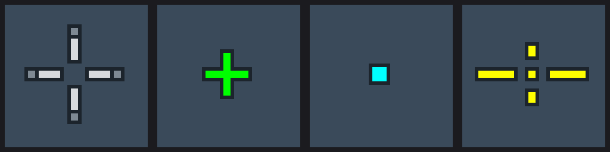
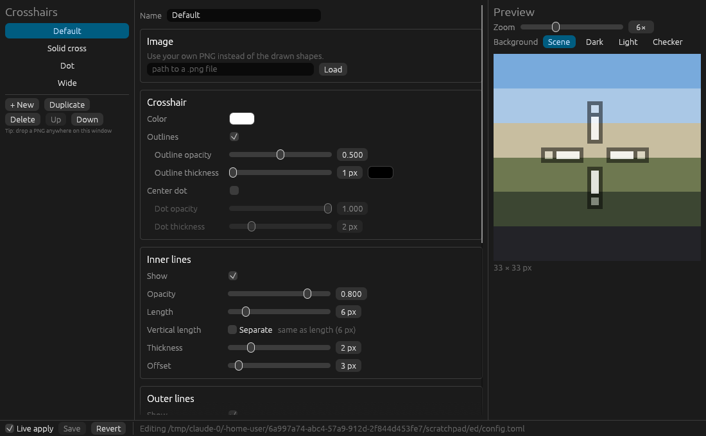

# crosslay

A crosshair overlay for Windows that costs nothing while you play, plus a separate editor for
designing crosshairs.



crosslay is two programs:

| Program | What it does | When it runs |
|---|---|---|
| `crosslay.exe` | Shows the crosshair. It draws once and then sleeps. | All the time while you play |
| `crosslay-editor.exe` | Designs crosshairs and saves them for the overlay | Only while you're changing something |

They never talk to each other directly. The editor writes a small file of ready-made pixels
(`overlay.bin`), and the overlay shows it. See [idea.md](idea.md) for the full design and the
reasoning behind it.

## Why it's light

- **Drawn once.** The overlay hands its pixels to the Windows compositor once with
  `UpdateLayeredWindow`. The compositor shows them on every frame; crosslay does nothing per
  frame.
- **No timers, no polling.** The overlay sleeps until Windows wakes it for a hotkey, a change in
  its data folder, a display change, or a new foreground window (to stay on top). An idle
  overlay uses 0 % CPU.
- **Right-click crosshair without a loop.** Both crosshairs are drawn up front into two windows.
  Pressing or releasing the right mouse button just shows one and hides the other. The button
  is read through raw input, which Windows posts after the fact, so it can never delay your
  mouse. It's only switched on for crosshairs that have a right-click version.
- **Nothing to parse.** The editor bakes crosshairs into raw pixels, so the overlay has no config
  parser, no PNG decoder and no drawing code. Its only dependency is the Windows API bindings.
- **No GUI toolkit or GPU context in the overlay.** Those live in the editor, which you close
  when you're done.
- **Small release build:** size-optimised, LTO, `panic = "abort"`, stripped, and statically
  linked so it needs no Visual C++ Redistributable.

It's an ordinary click-through, top-most window. It never takes focus, isn't in Alt+Tab, and
doesn't touch any game process, so anti-cheat has nothing to object to. That also means it shows
over **windowed and borderless-windowed** games, not exclusive fullscreen.

## Getting started

1. Download the zip for your PC (x64 or ARM64) from
   [Releases](../../releases), or from the latest *CI* run in the Actions tab.
2. Unzip both exes into the same folder.
3. Run `crosslay.exe`. You'll see a default green crosshair.
4. Press **Ctrl+Alt+M** (or run `crosslay-editor.exe`) to design your own. Changes appear on the
   overlay while you edit.

To start crosslay with Windows, put a shortcut to `crosslay.exe` in `shell:startup`.

## Hotkeys

| Hotkey           | Action                       |
|------------------|------------------------------|
| `Ctrl+Alt+X`     | Show / hide the crosshair    |
| `Ctrl+Alt+M`     | Open the editor              |
| `Ctrl+Alt+Right` | Next crosshair               |
| `Ctrl+Alt+Left`  | Previous crosshair           |
| `Ctrl+Alt+Q`     | Quit the overlay             |

You can change or turn off any of them in the editor under *Settings & hotkeys*. If another
program already uses one, the overlay tells you at startup and keeps running without it.

## The editor



- **Profiles:** create, duplicate, delete, rename and reorder crosshairs, then cycle through them
  in game with the hotkeys.
- **Valorant-style settings:** colour, outlines (opacity, thickness), centre dot (opacity,
  thickness), and **inner and outer lines**, each with show, opacity, length, thickness and
  offset. Each set of lines can have a **separate vertical length**, so you can make a wide or
  tall crosshair. An offset of 0 makes the lines meet in a solid cross.
- **Right-click crosshair:** give any crosshair a second look to show while the right mouse
  button is held, for aiming down sights. Click *Add a right-click crosshair*, then switch
  between *Normal* and *Right mouse held* to edit each one; the preview follows. Under
  *Settings & hotkeys* you can make each right click toggle it instead, for games with toggle
  aim.
- **Valorant crosshair codes:** paste a code from Valorant (*Settings > Crosshair > Import
  Profile Code*) to copy its primary crosshair (or its ADS crosshair, when you're editing the
  right-click crosshair), or copy any crosshair out as a code to use in the game. Movement and
  firing error are ignored because they don't apply to an overlay.
- **Your own PNG:** choose a file, type a path, or drop a PNG on the window. It's copied into an
  `images` folder so it keeps working if you move the original.
- **Live preview** at real size or zoomed in, on game-like, dark, light or checkerboard
  backgrounds.
- **Live apply** (on by default) saves each change after a short pause, and the running overlay
  updates straight away. Turn it off to use **Save** and **Revert** yourself.
- **Start overlay** starts `crosslay.exe` if it isn't running.
- **Updates:** a banner offers new versions, and *Settings & hotkeys > Updates* has
  *Check now*. See [Updates](#updates).

The crosshair selected in the editor is the one the overlay shows.

### Command line

```
crosslay-editor                    # open the editor
crosslay-editor --bake             # bake config.toml into overlay.bin, no window
crosslay-editor --preview out.png  # render the selected crosshair to a PNG
crosslay-editor --update           # install a newer release, if there is one
crosslay-editor --version          # print the version
crosslay-editor --print-config     # print the default, commented config
crosslay-editor --data-dir         # show which data folder is used
crosslay-editor --dir <folder>     # use another data folder (works with all of the above)
crosslay --dir <folder>            # run the overlay on another data folder
```

## Files

Both programs use the same data folder:

- `%APPDATA%\crosslay\` normally.
- **Portable mode:** if a `config.toml` sits next to the exes, that folder is used instead.

| File | Who writes it | What it is |
|---|---|---|
| `config.toml` | Editor (or you) | Your crosshairs and settings, as readable text |
| `overlay.bin` | Editor | The same crosshairs baked into pixels. This is the only file the overlay reads |
| `images/` | Editor | PNGs you imported |

If you edit `config.toml` by hand, run `crosslay-editor --bake` afterwards, or just open the
editor, which re-bakes when the text file is newer. Here's what a crosshair looks like:

```toml
monitor = 0             # 0 = primary monitor, 1.. = other monitors
profile = 0             # crosshair shown at startup
visible = true
auto_update = true      # check for a new version when the overlay starts
right_click = "hold"    # or "toggle": how right-click crosshairs switch

[hotkeys]
toggle = "Ctrl+Alt+X"
editor = "Ctrl+Alt+M"
next = "Ctrl+Alt+Right"
previous = "Ctrl+Alt+Left"
quit = "Ctrl+Alt+Q"     # "" turns a hotkey off

[[crosshair]]
name = "Default"
color = "#FFFFFF"       # "#RRGGBB" or "#RRGGBBAA"
outlines = true
outline_opacity = 0.5
outline_thickness = 1
outline_color = "#000000"
center_dot = false
center_dot_opacity = 1.0
center_dot_thickness = 2
image = ""              # PNG to show instead of the shapes, e.g. "images/scope.png"
image_scale = 1.0
opacity = 1.0           # 0.0 to 1.0, applies to the whole crosshair
offset_x = 0
offset_y = 0

[crosshair.inner_lines]
show = true
opacity = 0.8
length = 6              # left and right lines
separate_vertical = false
vertical_length = 6     # top and bottom lines, when separate_vertical = true
thickness = 2
offset = 3              # gap from the centre; 0 = the lines meet

[crosshair.outer_lines]
show = true
opacity = 0.35
length = 2
separate_vertical = false
vertical_length = 2
thickness = 2
offset = 10
```

These are Valorant's defaults. Any field you leave out takes its default.

To show something else while the right mouse button is held, add a `right_click` table to the
crosshair. It takes the same fields:

```toml
[crosshair.right_click]
center_dot = true

[crosshair.right_click.inner_lines]
show = false

[crosshair.right_click.outer_lines]
show = false
```

### Right-click crosshair and resource use

A crosshair without a right-click crosshair costs exactly what it did before: the overlay doesn't
listen to the mouse at all. With one, Windows sends the overlay every mouse report (there's no
way to ask for button presses only). The overlay reads them in batches at most every 4 ms, checks
for a right-button change and goes back to sleep, so the swap is at most 4 ms late. The CI run measures this cost; see *Measure* below. If a game runs as
administrator, run `crosslay.exe` as administrator too, or Windows won't pass it that game's
mouse input.

## Updates

When `auto_update` is on (the default), the overlay starts `crosslay-editor --update` once each
time it starts. That separate, short-lived process asks GitHub for the latest release. If it's
newer, it downloads both exes, briefly stops the overlay, swaps the files, and starts the
overlay again. The overlay itself never touches the network, and nothing runs after that check.

- Turn it off in the editor (*Settings & hotkeys > Updates*) or with `auto_update = false`.
- The editor also checks when it opens, and shows a banner with an **Install and restart**
  button.
- `crosslay-editor --update` runs the same check from a terminal.
- Updates replace the exes in place, so keep them in a folder you can write to (not
  `Program Files`).
- Updates come from this repository's GitHub Releases over HTTPS, and only for the Windows
  builds.

## Building

You need Rust (stable). From the repository root:

```
cargo build --release
```

That builds `target/release/crosslay.exe` and `target/release/crosslay-editor.exe`. To build
just one, add `-p crosslay` or `-p crosslay-editor`.

The overlay is Windows-only. On Linux and macOS it builds to a stub that says so. The editor,
`--bake`, `--preview` and the tests run anywhere (the PNG file picker button is Windows-only;
elsewhere, type a path or drop a file).

### GitHub Actions

One workflow, **CI** (`.github/workflows/ci.yml`), runs on every push and can be started by hand
from the Actions tab (*Run workflow*). It has four jobs:

1. **Test** runs `rustfmt`, Clippy and the tests on Linux and Windows.
2. **Build** builds both exes for Windows x64 and ARM64. Download them from the run's
   *Artifacts* section, and see their sizes in the run summary.
3. **Measure** runs the x64 overlay idle for 20 seconds, then feeds it 20,000 synthetic mouse
   moves with and without a right-click crosshair, and checks that holding the right button
   swaps the crosshair. Memory, CPU time (including microseconds per mouse move), threads,
   handles and loaded DLLs go in the run summary.
4. **Release** runs only for a version tag. It publishes a GitHub Release with a zip per
   architecture plus the bare exes the updater downloads.

To release, bump `version` in the root `Cargo.toml` and merge. Then either:

- In the Actions tab, open **CI**, choose **Run workflow** on the default branch, tick
  **Publish a release** and run it. The release job creates the `v<version>` tag itself.
- Or push a tag yourself: `git tag v0.1.0 && git push origin v0.1.0`.

Either way, the release fails if the tag and the version don't match, so the updater never sees a
release that reports the wrong version.

## Layout

```
crates/
  format/    crosslay-format: the overlay.bin reader and writer, plus the data-folder rule.
             No dependencies. Used by both apps.
  overlay/   crosslay: the overlay. Win32 only, depends on crosslay-format and windows-sys.
  editor/    crosslay-editor: the egui editor, config.toml handling, the crosshair
             rasteriser, PNG import, Valorant codes, the updater, and
             --bake / --preview / --update.
```
